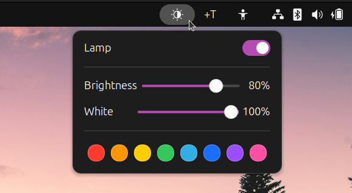

# tuya-beacon-linux

**Controle uma lâmpada Tuya só-Bluetooth pelo seu PC com Linux. Sem celular, sem gateway, sem nuvem.**

[Read in English](README.md)

Muita lâmpada Tuya / Smart Life barata não tem Wi-Fi. Ela fala *Beacon Mesh*: anúncios Bluetooth de mão única. A Tuya diz que é preciso um gateway. O Bluetooth do seu notebook manda os mesmos anúncios.


```
lamp on | off
lamp bright 30          # 1-100
lamp temp 80            # branco, 0 quente .. 100 frio
lamp color purple       # red orange yellow green cyan blue purple pink, ou matiz 0-359
```

Ou pela barra do topo, no GNOME:



## O byte que ninguém documenta

- O anúncio **precisa começar com o elemento Flags `02 01 06`**.
- Sem ele, a lâmpada ignora comandos que de resto estão perfeitos, mesmo iguais byte a byte aos do celular.
- O texto público mais completo sobre o protocolo não traz isso.

Mais em [docs/protocol.md](docs/protocol.md) (em inglês).

## Serve para a minha lâmpada?

- Ela funciona no app Tuya ou Smart Life só por Bluetooth (pareada sem Wi-Fi).
- O `capture` (primeiro passo da instalação) escuta o desliga e o liga dela. Se não ouvir nada, veja o [docs/alternatives.md](docs/alternatives.md).
- **Uma lâmpada** por PC, por enquanto ([mais lâmpadas](https://github.com/oLucasAguilar/tuya-beacon-linux/issues/1)).
- Testado em uma lâmpada, Ubuntu 24.04, GNOME 46: [docs/limits.md](docs/limits.md).

## Instalar

**O que você precisa**

- A lâmpada pareada num destes apps de celular:
    - **Tuya** (Google Play: *Tuya - Smart Life, Smart Living*, da Tuya Smart Inc.)
    - **Smart Life** (*Smart Life - Smart Living*)
    - Outros apps de marca feitos sobre a Tuya: não testados.
- O celular à mão, com a lâmpada por perto.
- Um PC com Linux no mesmo cômodo, **com o Bluetooth ligado**, Python 3.8+ e systemd.

**Passos**

```bash
git clone https://github.com/oLucasAguilar/tuya-beacon-linux && cd tuya-beacon-linux
```

1. **Deixe o PC escutar a lâmpada.**
    ```bash
    sudo bin/tuya-beacon capture
    ```
    Enquanto ele escuta, abra o app no celular e **desligue e ligue** a lâmpada. O PC pega os dois comandos pelo Bluetooth.

2. **Pegue a chave da lâmpada.**
    ```bash
    bin/tuya-beacon login
    ```
    Digite o seu user code (app: Eu > Configurações > Conta e segurança) e escaneie o QR que aparece com o mesmo app. [Por que um QR code?](#por-que-um-qr-code)

3. **Teste.**
    ```bash
    sudo bin/tuya-beacon off
    ```
    A lâmpada apaga. Pronto, o PC fala com ela.

4. **Instale.** Escolha um:
    ```bash
    sudo ./install.sh --gnome     # comando `lamp` + menu na barra do topo (GNOME)
    sudo ./install.sh             # só o comando `lamp`, em qualquer desktop
    ```
    Daqui em diante, `lamp on` funciona sem `sudo`. O menu aparece depois que você sai e entra de novo na sessão. Como isso fica seguro: [docs/limits.md](docs/limits.md#by-design) (em inglês).

O login por QR não funcionou? Pegue a chave no site de desenvolvedor da Tuya: [docs/local-key.md](docs/local-key.md) (em inglês).

### Por que um QR code

- Os comandos são cifrados com a chave da sua lâmpada, que nunca passa pelo ar.
- O `login` lê essa chave uma vez da sua conta no app.
- O app pode pedir para confirmar "Home Assistant". [Por quê](docs/limits.md#by-design) (em inglês).
- Depois da configuração, nada mais fala com a nuvem.

**Prefere que o Claude instale?** Cole no Claude Code:

```
Instale o tuya-beacon-linux seguindo https://github.com/oLucasAguilar/tuya-beacon-linux/blob/main/llms-install.md
```

Ele roda os passos e avisa quando é a sua vez (o celular, o `sudo`).

## Só o código

Vai fazer a sua própria interface? Dois arquivos pequenos fazem o trabalho:

```python
from tuyabeacon import p2
from tuyabeacon.radio import Radio

frame = p2.build_frame(src=b"\x80\x01", dst=b"\x00\x02", seq=1000,
                       payload=p2.ON, local_key=local_key, beacon_key=beacon_key)
Radio("hci0").advertise([p2.advertisement(frame)])   # precisa de root ou CAP_NET_RAW
```

- [`tuyabeacon/p2.py`](tuyabeacon/p2.py): quadros, payload de DP, recuperação da beaconKey
- [`tuyabeacon/radio.py`](tuyabeacon/radio.py): anúncio e escuta pelo HCI cru
- [`tuyabeacon/lamp.py`](tuyabeacon/lamp.py): o mapa de DP e o estado por trás do `lamp`
- Testes: `python3 -m unittest discover tests`

## Créditos

Feito em cima da engenharia reversa de outras pessoas: [NOTICE.md](NOTICE.md). Licença MIT.
